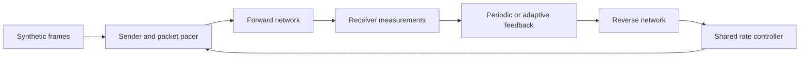
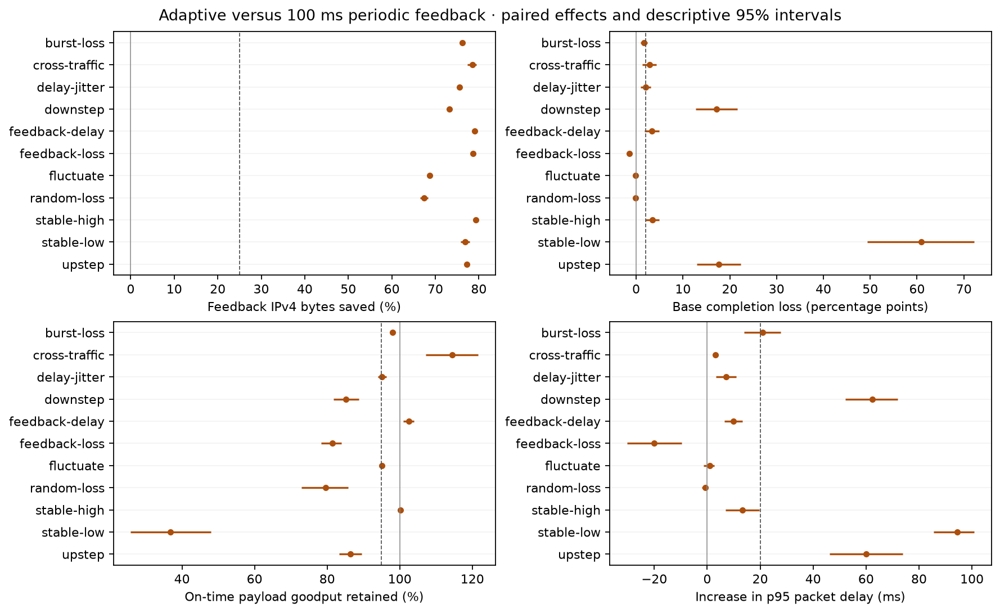

<div align="center">

# Low-overhead adaptive bandwidth control

**Measuring the cost of receiver feedback in synthetic real-time media**

Java 21 · UDP · Deterministic simulation · Paired experimental evaluation

[Report](report.md) · [Word report](submission/02_Report/Research_Report.docx) · [Presentation](submission/01_Presentation/ppt.pptx) · [Project guide](PROJECT_GUIDE.md)

</div>

---

## The question

Can a receiver send fewer congestion reports while preserving on-time delivery and fast adjustment to bandwidth changes?

We built a Java UDP sender and receiver, a deterministic network simulator, and an analysis pipeline. The primary comparison keeps the controller fixed and changes the receiver's reporting schedule.

| Periodic feedback | Adaptive feedback |
| --- | --- |
| One report every 100 ms | Early reports under sustained congestion |
| Regular observation updates | 500 ms fallback heartbeat |

## What the study found

| Main held-out result | Observation |
| --- | --- |
| Feedback bytes saved | **68.76%** |
| Goodput retention lower confidence bound | **94.49%**, below the 95% requirement |
| Additional downstep settling time | **433 ms**, above the 200 ms margin |
| Additional upstep settling time | **647 ms**, above the 200 ms margin |
| Joint decision | **Five of eight criteria cleared** |

The study used **450 tuning simulations**, **2,310 held-out simulations** and **24 audited live UDP trials**. Adaptive reduced feedback overhead on the primary fluctuating workload and missed the combined delivery and response requirements.

[Inspect the saved analysis](experiments/summary/analysis.json) · [Explore run-level data](experiments/summary/runs.csv)

## Architecture



The source offers 50 synthetic frames per second with a 150 ms deadline. Each frame offers two base packets and eight enhancement packets. The receiver measures finalized loss and relative transit change. The sender adjusts its target rate using fresh feedback.

The simulator reuses endpoint logic with virtual time and explicit queues. Live UDP runs verify packet exchange and controlled path effects.

## Quick start

Install **Java 21**, **Maven** and, for the optional scenario validator, **Python 3**.

```sh
git clone https://github.com/SayanMajhi/Low-overhead-adaptive-bandwidth-control.git
cd Low-overhead-adaptive-bandwidth-control
mvn -B clean verify
python3 experiments/verification/scenarios.py
```

Run a periodic/adaptive pair from a Bash terminal on Linux, macOS, or WSL:

```sh
DEMO_DIR=$(mktemp -d)
for arm in periodic adaptive; do
  java -jar target/bandwidth-control.jar simulate \
    --scenario config/scenarios/tuning/tune-variable.json \
    --profile config/profiles/frozen-study.json \
    --arm "$arm" --seed 520101 --out "$DEMO_DIR/$arm"
done
printf 'Outputs: %s\n' "$DEMO_DIR"
```

For Windows PowerShell, use a fresh output directory for each invocation:

```powershell
java -jar target/bandwidth-control.jar simulate --scenario config/scenarios/tuning/tune-variable.json --profile config/profiles/frozen-study.json --arm periodic --seed 520101 --out demo-periodic
java -jar target/bandwidth-control.jar simulate --scenario config/scenarios/tuning/tune-variable.json --profile config/profiles/frozen-study.json --arm adaptive --seed 520101 --out demo-adaptive
```

Each run writes its input copies, manifest, endpoint and link logs, emission bins and summary. Verify matching impairment trace hashes before comparing feedback bytes, on-time goodput and frame completion.

## Results and evidence



| Included on GitHub | Retained with the full local project |
| --- | --- |
| Source, tests, profiles and scenarios | Original simulation run archives |
| Frozen study manifest and audit tools | Live packet logs and captures |
| Run tables, paired effects and figures | Frozen campaign JARs |
| Final presentation and reports | Historical cleanup and preservation records |

Full raw evidence occupies about **3.9 GB** and is excluded through `.gitignore`. The compact copies in [experiments/summary](experiments/summary) retain the original measured values. Their provenance file identifies the source paths.

A fresh checkout supports builds, tests and new simulator runs. Reconstructing archived packet-level statistics, live-trial audits, or exact frozen replay requires restoring `experiments/results` from the full academic submission. Exact replay also requires the recorded Java build and original campaign JAR. The README does not provide a hosted raw-data download because none has been supplied.

## Repository map

```text
src/                   Java endpoints, simulator and JUnit tests
config/                Controller profiles and workload inputs
scripts/               Simulation campaigns and live UDP tooling
analysis/              Statistics, bootstrap indices and figure generation
experiments/protocol/  Frozen study manifest
experiments/summary/   Compact public results and figures
experiments/verification/ Correctness checks and evidence auditors
submission/            Final report, presentation and viva materials
report.md              Academic report source
PROJECT_GUIDE.md       Beginner-to-engineer explanation and file map
```

## Verification

```sh
mvn -B clean verify
python3 experiments/verification/scenarios.py
python3 experiments/verification/simulator.py /tmp/cn-simulator-check
python3 experiments/verification/controller.py /tmp/cn-controller-check
```

Use fresh directories for the verification harnesses. The recorded suite contains **23 JUnit tests**. GitHub Actions runs the Java build and scenario validator on pushes and pull requests. The workflow's first remote run will occur after upload.

For analysis, install the versions in `analysis/requirements.txt`. New isolated shaping trials require Linux namespaces, `unshare`, `ip` and `tc`.

## Scope and next steps

The study measures synthetic traffic and packet deadlines. Playback quality, responsiveness against contemporary deployed systems and fairness against responsive flows need additional experiments.

The exploratory 200 ms heartbeat candidate settled faster on three tuning seeds, with mixed goodput and more feedback. It needs a fresh held-out evaluation.

## References and attribution

- Carlucci et al., *Analysis and Design of the Google Congestion Control for Web Real-time Communication*, MMSys 2016. [Paper](https://doi.org/10.1145/2910017.2910605)
- Sarker et al., *RTCP Feedback for Congestion Control*, RFC 8888. [RFC](https://www.rfc-editor.org/rfc/rfc8888.html)
- Perkins, *Sending RTCP Feedback for Congestion Control in Interactive Multimedia Conferences*, RFC 9392. [RFC](https://www.rfc-editor.org/rfc/rfc9392.html)
- Postel, *User Datagram Protocol*, RFC 768. [RFC](https://www.rfc-editor.org/rfc/rfc768.html)

AI assistance and review provenance are disclosed in the report. The repository owner should describe the work they personally implemented, understood and checked.

[Open the academic submission](submission/START_HERE.md)
