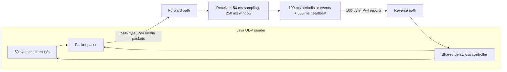

# Low-overhead adaptive bandwidth control for synthetic video traffic

**Source repository:** [https://github.com/SayanMajhi/Low-overhead-adaptive-bandwidth-control](https://github.com/SayanMajhi/Low-overhead-adaptive-bandwidth-control)

## Abstract

Can a real-time media receiver send fewer congestion reports while preserving timely delivery? We tested a bounded event-triggered policy against 100 ms periodic reports with a shared Java 21 sender, receiver measurements, wire format, and pacer. In 30 paired runs of the prespecified fluctuating workload, adaptive feedback saved **68.76%** of emitted IPv4 feedback bytes and cleared the on-time base completion and p95 packet delay margins. The lower confidence bound on goodput retention was **94.49%**, below the required 95%. Both capacity-step timing margins also failed. The controlled evaluation did not support the joint hypothesis. Twenty-four real UDP impairment trials additionally verified the shared controller and feedback path; capped adaptive trials showed higher RTT despite similar delivered throughput.

## Objectives

1. Build a paced Java UDP sender and receiver for synthetic video packets with delivery deadlines.
2. Compare periodic and adaptive feedback while holding the sender controller and receiver measurements fixed.
3. Measure feedback cost, on-time delivery, packet delay, and response after capacity changes.
4. Validate the implementation over isolated UDP paths and document conditions where adaptive feedback falls short.

## Prior work and contribution

When offered traffic exceeds a bottleneck's capacity, queues add delay and can begin dropping packets. A receiver can report less often during quiet periods and still issue warnings when it observes congestion. That saves reverse bandwidth at the risk of slower reaction or recovery. Historical GCC already paired periodic reporting with early updates after some estimate decreases. RFC 8888 specifies congestion feedback data and RFC 9392 discusses cadence and overhead. SCReAM and the November 2026 SCReAMv2 draft provide further examples of varying feedback frequency. The contribution here is a controlled measurement of the feedback and delivery trade-off for one small controller. [Literature and market review](report.md)

## Implementation and Computer Networks concepts

The implementation uses Java 21, Maven and UDP sockets. UDP gives the application control of message format, packet pacing and feedback timing. The study keeps payload size and the sender controller fixed so a policy difference can be attributed to the receiver schedule.

A bottleneck queue holds packets when traffic arrives faster than the link can serve them. The simulator implements a finite FIFO queue in `SimulatedLink.java`. New packets are dropped if the waiting-byte limit is exceeded. The forward and reverse paths are modeled separately. Pacing spaces departures at the current target rate. Congestion control chooses that target from delay and loss observations.

Throughput measures delivered data per second under a specified byte definition. On-time goodput counts useful payload arriving before a deadline. Jitter describes changing packet delay. Corrected RTT measures a round trip using a sender-local timestamp echo and receiver hold time. The system tracks sequence numbers to distinguish gaps, duplicates and reordering.

| Code or directory | Role |
| --- | --- |
| `src/main/java/org/bandwidthcontrol/Main.java` | Entry point for send, receive and simulate commands |
| `Sender.java`, `Pacer.java` | Generate frames, pace packets and apply the target rate |
| `Receiver.java`, `ReceiverMeasurements.java` | Receive datagrams and measure loss and relative transit change |
| `Datagrams.java` | Encode and validate the custom packet format |
| `FeedbackSchedule.java`, `Congestion.java` | Schedule reports and classify receiver evidence |
| `RateController.java` | Handle growth, congestion reductions and stale evidence |
| `Transport.java` | Drive real UDP endpoints |
| `Simulation.java`, `SimulatedLink.java`, `ImpairmentTrace.java` | Virtual time, queues and reproducible network conditions |
| `Events.java`, `Metrics.java` | Telemetry and per-run simulator summaries |
| `config/` | Frozen controller settings and workload inputs |
| `analysis/` | Aggregate statistics and figures |
| `experiments/` | Original results and verification tools |

## Design

Each frame offers two required 500-byte base payloads and eight optional enhancement payloads and has a 150 ms deadline. The sender assigns sequence numbers on successful handoff. The receiver allows 75 ms for a gap to fill before finalizing loss. At 800 kb/s the 568-byte IPv4 media packet occupies 5.68 ms. Pacing schedules from the last actual send, avoiding catch-up bursts after a late wakeup.

The receiver compares arrival spacing to send spacing. Two packets sent 20 ms apart and received 35 ms apart experienced a 15 ms rise in relative transit delay. Taking the difference of local intervals cancels a constant clock offset. Jitter and drift can still affect the signal. The sender consumes at most one new admissible observation per 100 ms tick, increases cautiously under healthy evidence, and backs off on congestion or stale evidence. The receiver applies the same measurement logic in both arms. The simulator reuses endpoint logic with a virtual clock and keeps capacity and queue truth outside the controller. [Architecture and wire format](report.md)

## Evaluation

The 450 tuning runs used six scenarios and ten distinct seeds. On the variable tuning workload the adaptive arm emitted 84,600 feedback IPv4 bytes over ten trials. Of nine periodic intervals, 350 ms came closest at 86,000 bytes. The interval was chosen using emitted bytes alone. The held-out campaign had 11 scenarios, 30 seeds, and seven arms, totaling 2,310 simulations. Alongside the primary arms, it included fixed bitrate, loss-only AIMD, heartbeat-only, the 350 ms comparator, and periodic reporting with the delay signal disabled. Arms in each pair shared the scenario, seed and directional impairment trace. Their packet timing and queues could differ. [Experiment protocol](report.md)

Byte savings and goodput retention use ratios of arm means. Base completion and packet p95 use means of paired differences. Settling requires staying in the post-step target band for 500 ms within a 5 s horizon. Java generated 100,000 bootstrap resamples of whole seed pairs. Independent verification reconstructed the primary outcomes from raw event logs and reproduced all eight guardrails. [Detailed analysis and commands](report.md) · [Independent evaluation](report.md)

| Guardrail | Adaptive effect | Required margin and observed bound | Outcome |
| --- | ---: | --- | --- |
| Feedback IPv4 bytes saved | 68.76% | Lower 68.56%, minimum 25% | Clears |
| On-time base completion loss | −0.16 pp | Upper +0.29 pp, maximum 2 pp | Clears |
| On-time payload goodput retained | 95.10% | Lower 94.49%, minimum 95% | Misses |
| Increase in p95 packet delay | +0.92 ms | Upper +2.43 ms, maximum 20 ms | Clears |
| Downstep increase in settling time | +433 ms | Upper +550 ms, maximum 200 ms | Misses |
| Upstep increase in settling time | +647 ms | Upper +720 ms, maximum 200 ms | Misses |
| Downstep and upstep settled counts | 30/30 in both arms, each step | Both ≥27, adaptive ≥periodic | Both clear |

On the primary workload, adaptive achieved 90.09% on-time base completion and 0.970 Mb/s on-time payload versus 80.07% and 0.939 Mb/s with 350 ms periodic reports. Adaptive also spent about 9% more signaling bytes than the 350 ms comparator, so this is a measured trade-off with unequal realized costs. In the stable-low case, base completion dropped from 99.16% periodic to 38.29% adaptive. The lowest-seed trace had persistently high queue occupancy with few rate cuts. A filled queue can have a small delay gradient even when absolute delay stays high. [Held-out figures](experiments/summary/figures)

## Real transport

All 24 planned live trials completed across four conditions, two policies and three repetitions. The final single-agent review reran the previously independent audit and verified endpoint joins, both interface captures, frozen profile identity, routes, transitions and queue counters. The audit passed every trial. Values below are means across three repetitions. RTT columns average each run's median in sender-time windows 12–18, 22–28 and 32–38 seconds.

| Case | Policy | Delivered payload Mb/s | Feedback IP bytes | RTT before / during / after, ms |
| --- | --- | ---: | ---: | --- |
| clean | periodic | 1.877 | 30000 | 0.24 / 0.26 / 0.20 |
| clean | adaptive | 1.877 | 5700 | 0.27 / 0.43 / 0.39 |
| cap | periodic | 0.816 | 30000 | 25.65 / 30.79 / 29.07 |
| cap | adaptive | 0.813 | 6667 | 53.87 / 129.12 / 75.26 |
| step | periodic | 1.259 | 30000 | 0.63 / 24.65 / 0.40 |
| step | adaptive | 1.257 | 7000 | 69.21 / 13.69 / 55.03 |
| reverse-delay | periodic | 1.874 | 30000 | 0.24 / 100.35 / 0.26 |
| reverse-delay | adaptive | 1.875 | 5700 | 0.39 / 100.32 / 0.27 |

Delivered payload counts the 10–40 s sender cohort received by drain. Feedback bytes use the receiver-side capture window. These live measures do not establish on-time frame completion. Corrected RTT uses the sender clock and subtracts receiver hold. The reverse-delay experiment shows an approximately 100 ms increase followed by recovery. The capped adaptive runs show higher RTT despite similar delivered throughput. Three local repetitions support transport validation, with no Internet-wide or viewer-quality conclusion.

[Audited trial rows](experiments/summary/live-audited.csv) · [Transport evaluation](report.md)

## Wireshark demonstration

A separate Windows loopback demonstration recorded both feedback policies in `periodic.pcapng` and `adaptive.pcapng`. The sender used UDP port 52000 and the receiver used port 52001. The display filter `udp.srcport == 52001 && udp.dstport == 52000` isolates receiver feedback.

| Policy | Media packets | Feedback reports during active sending | Median time between reports |
| --- | ---: | ---: | ---: |
| Periodic | 514 | 79 | 94 ms |
| Adaptive | 513 | 14 | 545 ms |

Counts and median gaps cover roughly eight seconds per run, from the first to the last captured media packet. The gap is the difference between consecutive feedback timestamps. The captures illustrate report timing on a quiet link. The held-out simulation comparison supplies the 68.76% savings result. [Original capture screenshots on slide 5](submission/01_Presentation/ppt.pptx)

## Repository and evidence availability

The GitHub source tree includes source code, configuration, audit tools, compact analysis tables and figures under `experiments/summary`. Full raw campaigns and preserved executable builds remain in the local academic project under `experiments/results`. They are excluded from ordinary Git uploads. Existing commands that reconstruct raw packet metrics or replay frozen archives require that full evidence directory. Fresh simulator demonstrations can be run from a normal source checkout.

## Limits and reproduction

The result applies to the tested controller, synthetic traffic and path schedules. On-time base completion is a packet-delivery proxy. It does not measure playback or visual quality. Packet p95 covers valid arrivals and should be read with loss and deadline completion. Fixed cross-traffic tests coexistence under offered load. Exploratory warmed component timing showed 50 ms median process CPU per measured repetition for each arm. Whole-application CPU or memory savings require further evidence. [Timing evidence](report.md)

Build with Java 21 and Maven. To reproduce the exact campaign, use the archived JAR, frozen inputs and recorded Corretto build. The README covers pair replay and running the analysis. [README](README.md) · [Freeze manifest](experiments/protocol/freeze.json) · [Demo guide](report.md)

Codex agents initially assisted with literature review, experimental design, implementation, independent checks and documentation. The owner subsequently requested single-agent completion. Final build, live audit and submission packaging were performed by the coordinating agent, without a new independent human review. Quantitative claims refer to preserved logs. The project owner should describe their own contribution and the evidence they personally checked.

## Selected paper and contribution audit

Carlucci et al. (2016), “Analysis and Design of the Google Congestion Control for Web Real-time Communication,” is the reference paper selected for this presentation. The repository did not designate one original paper. Its historical GCC design estimates inter-group delay variation with a Kalman filter and an adaptive overuse threshold, combines receiver and sender decisions, and reports receiver estimates periodically or on a sufficient decrease. In a specific three-flow, 3 Mb/s test, Table 2 reported 86% utilization and Jain fairness 0.93. Its scenarios included variable capacity and competing traffic. These results are not directly comparable to our custom controller. https://doi.org/10.1145/2910017.2910605

| Component | Classification and evidence |
| --- | --- |
| Delay variation and event feedback | Adapted from established prior work. The lab uses a simpler endpoint-window calculation, not GCC’s Kalman filter. |
| Packet format, paced Java UDP endpoints and virtual-clock network | Independently implemented in this repository. The packet format is custom, not RTP or RTCP. |
| Identical controller with periodic and bounded event feedback | New experimental exploration of cadence under a fixed implementation. No claim of algorithmic novelty. |
| 200 ms heartbeat candidate | Implemented and checked on three tuning seeds after the frozen study. It has not passed a held-out analysis. |
| Real encoded video and playback | Future work. |

The congestion signal uses a 250 ms window of finalized losses and relative transit change. A relative change compares receiver and sender elapsed intervals, so constant clock offset cancels. A report is high if finalized loss is at least 5% with at least ten outcomes or if delay change reaches 12 ms. Two consecutive high receiver samples enter the event latch. While high persists, reports have a 100 ms minimum spacing; quiet conditions use a 500 ms heartbeat. A sender tick consumes at most one fresh report. Under high evidence the hybrid rate is multiplied by 0.85, with 200 ms spacing between decreases. Healthy fresh evidence increases at 300,000 bit/s per second of credited time, subject to bounds and freshness. Missing evidence triggers a 0.85 reduction after the stale threshold. Parameters and cases are fully defined in report.md#design and experiments/protocol/freeze.json.

For emitted feedback bytes B and measurement duration T, overhead is 8B/T bit/s. Feedback savings is 1 minus mean adaptive bytes divided by mean periodic bytes. On-time payload goodput is eight times unique payload bytes received by each frame deadline, divided by T. Base completion uses all generated frames as its denominator. On the primary workload the comparison is paired by scenario and seed. One-sided 95% bootstrap bounds use 100,000 resamples of 30 whole pairs. Failure of any of the eight predefined gates prevents support for the joint hypothesis.

The subsequent 200 ms heartbeat candidate used three tuning seeds and did not receive a new held-out evaluation. Mean goodput improved on the variable and downstep tuning workloads and decreased on upstep, while feedback bytes approximately doubled. It cannot be reported as resolving the frozen study’s failed thresholds. See report.md#limits-and-reproduction.

## Conclusion and future work

The Java testbed ran over both simulated and live UDP paths. Adaptive feedback reduced emitted feedback bytes on the primary fluctuating workload, but the goodput confidence bound and both capacity-step timing bounds missed their requirements. Five of the eight predefined checks passed, so the study did not support the joint hypothesis.

A follow-up should freeze the 200 ms candidate settings and assess them on fresh workloads against the same criteria. A second direction is detecting queues that stay full even when delay growth is small. Experiments with encoded media and playback metrics would test how the packet-level trade-offs affect viewers.

## References

1. G. Carlucci et al., “Analysis and Design of the Google Congestion Control for Web Real-time Communication,” MMSys 2016, https://doi.org/10.1145/2910017.2910605.
2. Z. Sarker et al., “RTP Control Protocol (RTCP) Feedback for Congestion Control,” RFC 8888, 2021, https://www.rfc-editor.org/rfc/rfc8888.html.
3. I. Johansson and Z. Sarker, “Self-Clocked Rate Adaptation for Multimedia,” RFC 8298, 2017, https://www.rfc-editor.org/rfc/rfc8298.html.
4. C. Perkins, “Sending RTCP Feedback for Congestion Control in Interactive Multimedia Conferences,” RFC 9392, 2023, https://www.rfc-editor.org/rfc/rfc9392.html.
5. X. Huang et al., “ACE: Sending Burstiness Control for High-Quality Real-time Communication,” SIGCOMM 2025, https://doi.org/10.1145/3718958.3750520.
